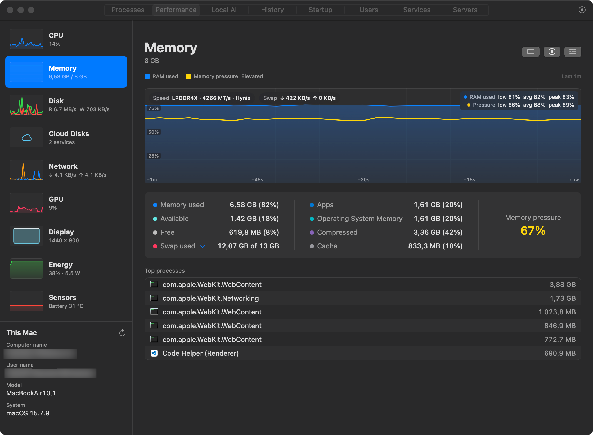
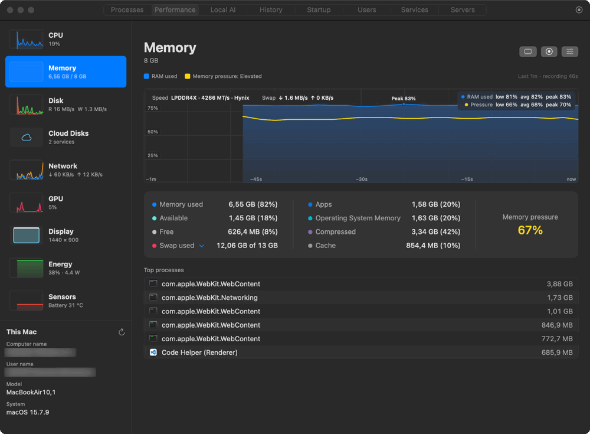
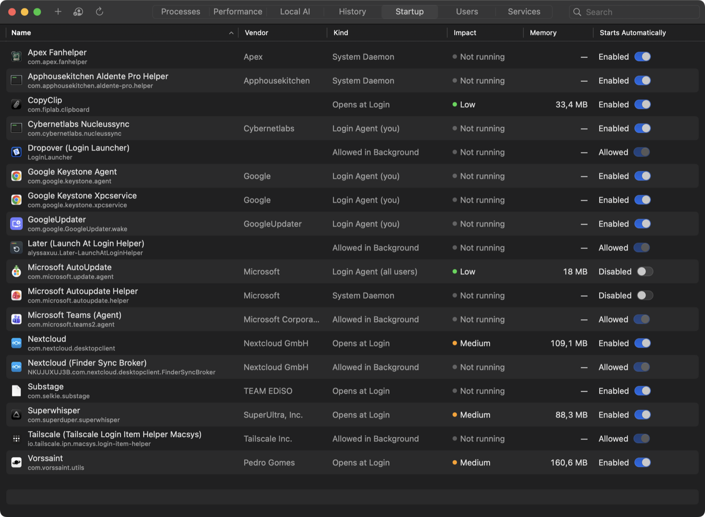
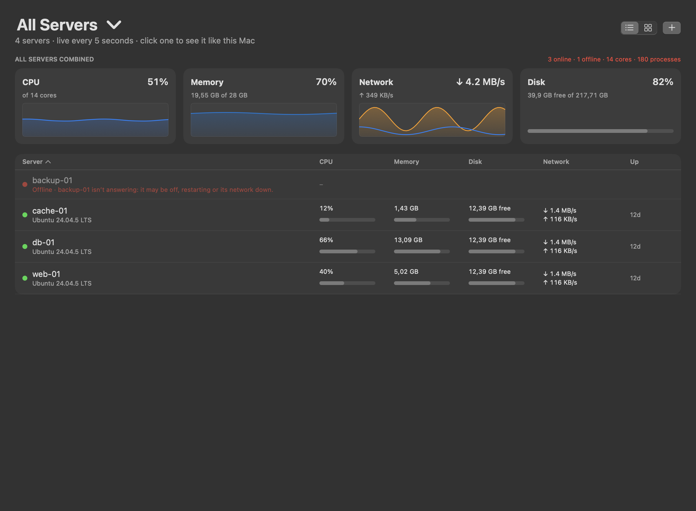
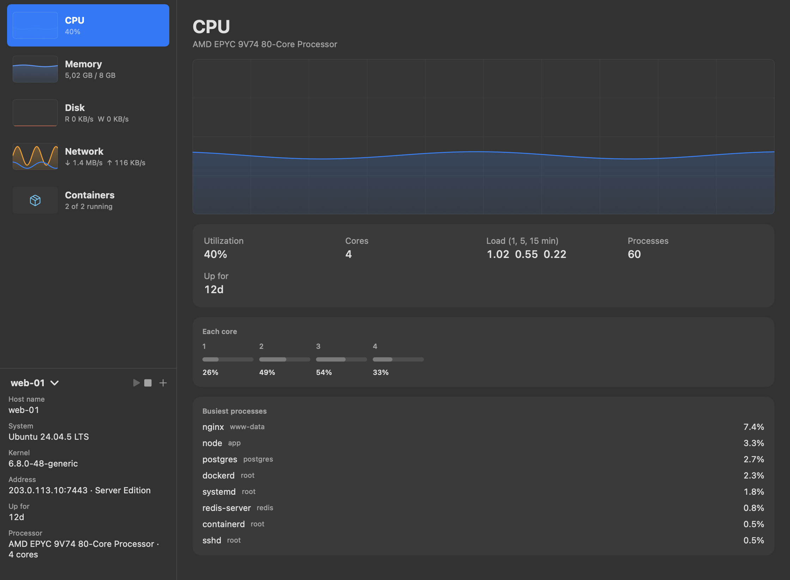
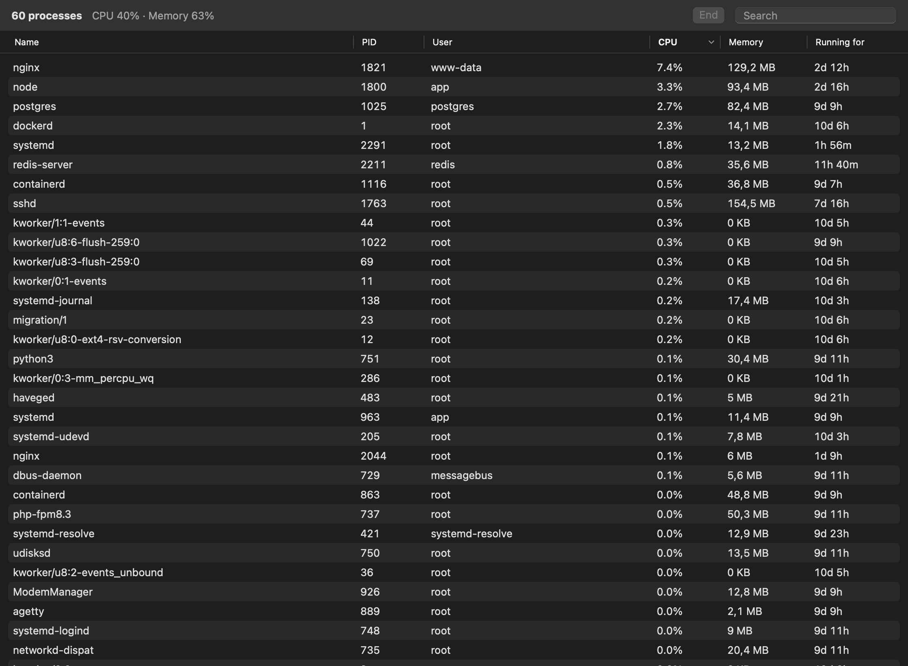
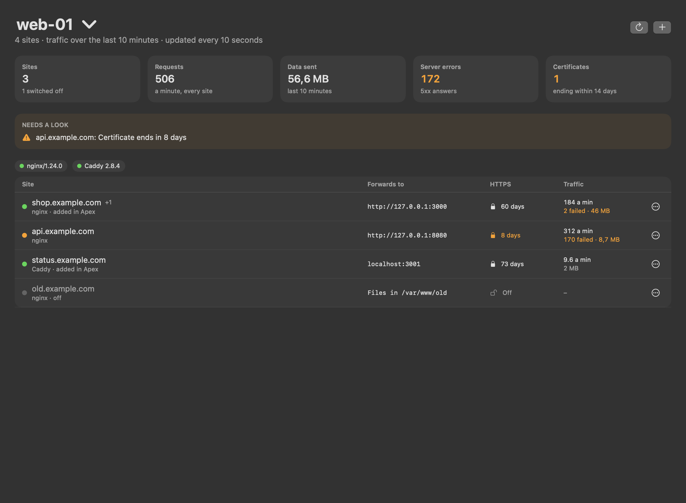
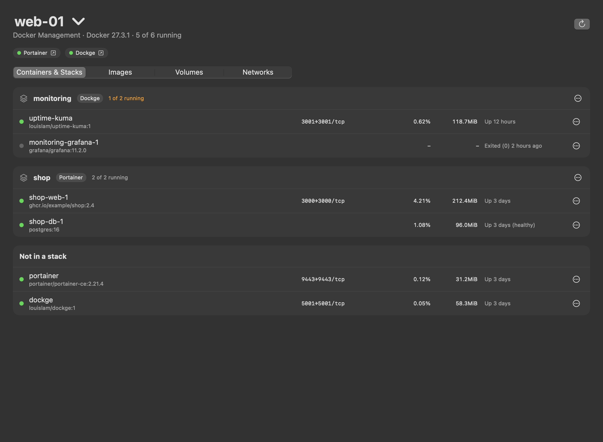

<div align="center">


# Apex Activity Manager

### One app for everything your Mac is doing.

See what's happening, understand why, and fix it: processes, performance,
storage, drives, battery and network in one light, native app.
By **CyberNet Labs**, designed and built by [**sudo-user**](https://github.com/sudo-user101).

<a href="https://github.com/sudo-user101/Apex-Activity-Manager-MacOSX/releases/latest"></a>


[Why Apex](#why-apex) · [Common problems](#common-problems-apex-solves) · [All features](#all-features) · [Install](#install) · [FAQ](#faq) · [License](#license)

</div>

## See it in action

<p align="center">
  
</p>

<p align="center">
  
</p>

## Why Apex

- **One app instead of several.** A system monitor, memory and disk
  clean-up, a drive checker, battery charge control, a bootable USB maker,
  a file shelf and more, in one window and one menu bar icon.
- **Explains, not just measures.** Alerts and diagnostics say what happened,
  why it matters and what to do, with the evidence behind them, not a wall
  of numbers.
- **Honest data.** Every number comes from macOS itself
  ([where each one comes from](docs/DATA-SOURCES.md)). When macOS doesn't
  expose something, Apex says so instead of guessing.
- **Lightweight.** Native Swift, under 10 MB, no tools spawned every
  second, and sampling pauses completely when the window is hidden.
- **Private.** No account and no analytics
  ([what Apex looks up online](#faq)).

## Common problems Apex solves

**"Why is my Mac so slow?"**
Open **Processes** to see which app is using the CPU, memory, disk or GPU,
and the **Memory** page for memory pressure (Normal / Elevated / Critical)
and swap. **Free Up Memory** optimizes or quits the heaviest apps and puts
them back later; **History** shows what was busy when it slowed down.

**"Why is my fan so loud?"**
**Sensors** shows CPU, GPU, chip and storage temperatures, and fan speeds on
Macs that have fans; the **CPU** page shows which processes are working the
processor hardest, and **Optimize** keeps an app running at background
priority on the efficiency cores, so it gives way to everything else.
Alerts tell you when the Mac is running hot.

**"My battery health keeps dropping."**
**Energy** shows health against the design capacity, cycle count, per-app
power use and a 12-hour charge history. Set a **charge limit** (50–100 %),
weekly **schedules**, or **night charging** so the battery doesn't sit at
100 % all day.

**"Why is my external drive so slow?"**
Each drive's page shows live reads and writes and the USB standard it's
actually running at, with a warning when a fast drive is stuck on a slow
port. **Drive Doctor** turns the drive's health data into findings with
steps to fix them, and **Check for Errors** runs macOS First Aid.

**"Which app is using my internet?"**
**Network** lists per-app traffic and every connection with its remote
host; double-click an app for its last 10 minutes of traffic and every
server it talked to. **Network Doctor** and a speed test help when the
connection itself is the problem.

**"My disk is almost full."**
**Storage › Analyze** shows what takes the space folder by folder, and
**Clean** lists caches, logs, leftovers of deleted apps, old installers,
build folders and the Trash for review. Nothing is deleted without your say.

## All features

### Performance at a glance

Live graphs for every part of the Mac, 1 to 10 minutes of history, and an
advanced graph with exact values on hover.

- **CPU:** total, user and system time, every core (efficiency and
  performance cores labelled); click the graph to see which processes use it.
- **Memory:** pressure (Normal / Elevated / Critical), apps, OS memory,
  compressed, cache, free, swap and how fast it's moving, RAM type and speed.
- **GPU:** utilisation, rendering and geometry load, memory, temperature,
  GPU restarts and the processes using the GPU, including local AI models.

<p align="center">
  
  
</p>

### Processes, grouped the way you think

- Apps with their helper processes folded underneath, then background and
  system processes; filter, search and sort by CPU, memory, disk, network,
  GPU or energy.
- An inspector for any process: what it is, where it lives, its signature
  and notarization, how long it has run, and its command line.
- End, End Tree, Pause / Resume, change priority, or **Optimize**: keep an app
  running at background priority on efficiency cores, hidden, until you
  restore it.

<p align="center">
  
</p>

### Free Up Memory, and put it all back

- See which apps hold the most memory, then **Optimize** them (they keep
  running but give way to everything else), **Quit** them, or clear the
  file cache.
- **Restore** brings optimized apps back on screen; **Reopen** relaunches the
  apps you quit, hidden ones hidden and the front one in front, with their
  windows where the app supports macOS window restoration.

<p align="center">
  
</p>

### Network

- Received and sent over time, your **local IP** per interface (Wi-Fi,
  Ethernet, VPN) marked private or public, router name and model, DNS.
- Per-app traffic and every connection with its remote host, plus listening
  ports with one click to free a port.

<p align="center">
  
</p>

### Drives, diagnosed

- A page for every drive as soon as it's plugged in: live reads and writes,
  the USB standard it's actually running at (and a warning if a fast drive is
  stuck on a slow port), capacity and volumes, and a one-click eject.
- **Drive Doctor** turns health data into findings: what was detected, why it
  matters, the evidence (from the drive itself, measured by Apex, or reported
  by macOS), severity and confidence, steps in order, and when to get help.
  It estimates remaining life only when the drive's own wear data supports it.
- Read-only **Check for Errors** with macOS First Aid; health changes go into
  History and notify you when a drive becomes at risk.
- **Transfers:** while files copy onto a drive its icon turns blue; see each
  file's progress and destination, cancel it, or move a finished copy that
  went to the wrong place.

<p align="center">
  
  
</p>

### Storage, for every drive

- **Optimize** maintenance tasks, **Analyze** what takes the space folder by
  folder, and **Clean** caches, logs, leftovers of deleted apps, old
  installers, build folders and the Trash.
- On external drives: analyze the drive, empty its own Trash, and remove the
  hidden helper files macOS leaves on Windows-formatted drives.
- Everything is listed for review first; nothing is deleted without your say.

<p align="center">
  
</p>

### Bootable Media Creator

A guided **Image → Drive → Customise → Review → Create** flow for Windows,
Linux and macOS installers, with checks before anything is erased and
verification afterwards.

- Reads a Windows image's editions, build and architecture straight from it.
- Windows 11 setup options, written as an answer file on the USB drive: skip
  the TPM / Secure Boot / RAM checks for older PCs, set up offline with a
  local account, use your region, fewer privacy prompts, and install apps
  such as Chrome, Firefox, VLC or VS Code at first sign-in.

<p align="center">
  
</p>

### Battery and energy

- Per-app power use, whole-Mac power draw, battery health, cycles and a
  12-hour charge history.
- **Charge limit** (50–100 %), **Charge to 100% Now**, weekly **schedules**,
  and **night charging**: hold a lower charge overnight and be full by
  morning, even with the lid closed.
- **Accessories:** every connected USB device (opening hubs and docks into
  what's plugged into them) with the power it's allowed; **stop** a USB drive
  and **resume** it without unplugging, and disconnect or reconnect
  Bluetooth accessories.

<p align="center">
  
</p>

### Alerts and history

- Notifications for things that matter: an app stuck on high CPU, memory
  pressure, swap growing, an app's memory climbing for half an hour, heat,
  low disk space, a disk filling fast, a drive's health getting worse.
- Short spikes are recorded but never notified; every event explains why it
  fired. Plus 30 days of per-app usage.

<p align="center">
  
</p>

### Startup, the whole picture

- Everything that starts automatically in one list: apps that open at login,
  background items apps registered with macOS, and launch agents and
  daemons, with readable names, icons, what each costs while running, and
  on/off where macOS allows it.
- Add App to open any app at login.

<p align="center">
  
</p>

### And more

- **Users** and **Services** (start, stop, restart), **Local AI** runtimes
  (Ollama, LM Studio, llama.cpp and more) with their models and memory, and
  an **Assistant** that answers questions about your Mac with a model running
  on it.
- **Menu bar** with Monitor, Energy, Shelf, Clipboard and Sessions tabs.
- **Display** brightness for any monitor, resolutions and AirPlay devices.
- **Network Doctor**, an internet speed test, your public IP, and each
  app's last 10 minutes of traffic.
- **Remove apps** with or without everything they left behind.
- **Servers and containers:** pick a Linux server or a Docker container from
  the This Mac menu and the whole app shows it: processes, performance,
  users, services, and a 1, 6 or 24-hour **Report** you can save as PDF.
  Connect over SSH, or install
  [Apex Server Edition](https://github.com/sudo-user101/Apex-Activity-Manager-Server-Edition)
  on the server for everything, encrypted, without SSH.

## Servers

All your Linux servers in one place: every server added up, each one like
this Mac, its websites and its Docker containers. Pair a server with
[Apex Server Edition](https://github.com/sudo-user101/Apex-Activity-Manager-Server-Edition)
(one command to install, one code to pair) or connect over SSH.

<p align="center">
  
</p>

- **All Servers:** CPU across every core of every server, memory, network
  and disk, with a sortable list. A server that's off or out of reach shows
  red and says why.
- **Each server, like this Mac:** Performance, Processes, Users, Services
  and a Report, with ▶ Resume and ■ Stop.

<p align="center">
  
  
</p>

- **Sites:** every site on nginx, Caddy, Traefik and Nginx Proxy Manager,
  where it forwards, when its certificate ends and its traffic. Add, edit
  and switch sites off; each change is checked by the proxy and undone if
  it's refused.
- **Docker Management:** containers by stack and the manager running them
  (Dockge, Portainer, Compose), logs, updates, compose files, images,
  volumes and networks.

<p align="center">
  
  
</p>

## Install

1. Download the latest **.dmg** from
   [Releases](https://github.com/sudo-user101/Apex-Activity-Manager-MacOSX/releases/latest).
2. Open it and drag **Apex Activity Manager** onto **Applications**.
3. Version 1.4.0 isn't notarized: the first time, macOS may say it can't check
   the app. Open **System Settings › Privacy & Security** and click
   **Open Anyway**. Releases signed with Developer ID and notarized by Apple
   open normally.

### Requirements

- macOS 14 Sonoma or later
- Apple silicon or Intel
- About 10 MB of disk space
- Your password only for the actions that need it ([which ones](SECURITY.md#when-apex-asks-for-your-password))

## FAQ

**Does Apex need administrator rights?**
No, not to monitor. You're asked for your password only for actions that
need it: charge limit and fan control (a small helper is installed once),
ending other users' processes, clearing the file cache, raw image writes.

**Will it slow my Mac down?**
It's built not to: about 6 % of one core while you watch the Processes view,
next to nothing when hidden, and it hands memory back to macOS when idle.

**Is anything sent over the internet?**
No. Apex has no analytics and no account. It only looks up what you see on
screen: your router's name, host names of connections, your public IP while
a Network page is open, and the speed test when you run it; and it talks to
local AI runtimes on your own Mac. "Check on VirusTotal" opens your browser
with the file's fingerprint, only when you click it. Details in the
[security policy](SECURITY.md#network-and-privacy).

**Why can't Apex switch off an accessory's power or show GPU watts?**
macOS doesn't let apps do the first, and only reports the second to
administrator tools. Apex tells you rather than showing made-up numbers.

## Build from source

```bash
./build.sh                       # dist/Apex Activity Manager.app for this Mac
./build.sh --universal --dmg     # Apple silicon + Intel, plus the installer .dmg
swift test                       # unit tests
```

Needs Xcode or the Command Line Tools (Swift 5.10+). Signed, notarized builds:
`./build.sh --universal --dmg --notarize` with your own Developer ID; see
[Releasing](docs/RELEASING.md).

| Path | What's there |
|---|---|
| `Sources/TaskManager/App` | App state and sampling loop, alerts, history, memory guard |
| `Sources/TaskManager/Sampling` | CPU, memory, disk, network, GPU and per-process samplers, device hot-plug |
| `Sources/TaskManager/System` | Battery, sensors, drive health and tools, storage, accessories, transfers, startup items |
| `Sources/TaskManager/Diagnostics` | The diagnostic model and Drive Doctor rules |
| `Sources/TaskManager/BootMedia` | Image inspection, Windows answer files, the media-creation job |
| `Sources/TaskManager/Views` | One file per page or panel |
| `Sources/DetectionCore` | Pure alert rules (samples in, events out) |
| `Sources/FanControlCore` | Pure fan, charge-limit, schedule and night-charging logic |
| `Sources/ApexFanHelper` | The privileged helper (installed only when you turn on charge or fan control) |
| `Tests/TaskManagerTests` | Unit tests |

More: [Architecture](docs/ARCHITECTURE.md) · [Releasing](docs/RELEASING.md) · [Where every number comes from](docs/DATA-SOURCES.md) · [AI diagnostics design](docs/AI-DIAGNOSTICS.md) · [Changelog](CHANGELOG.md)

## Every computer

Apex's direction is simple: **if it's a computer, it can run Apex.** One app,
the same pages and the same plain words on every operating system and every
kind of hardware:

- **macOS:** Apple silicon and Intel.
- **Windows:** x64 and ARM64 PCs.
- **Linux:** desktops and servers, x86_64 and ARM (64- and 32-bit), the main
  distributions and the small ones.
- More to come, as they're tested: older versions of each system, and other
  operating systems.

Some features depend on what each system allows (fan control or battery
charge limits, for example), so an edition may have fewer of them. When it
does, the app says so plainly instead of hiding the page. Install should
never be the thing that stops you.

## Roadmap

See the [open issues](https://github.com/sudo-user101/Apex-Activity-Manager-MacOSX/issues) for what's being worked on next.

- The **Windows** edition ([Apex for Windows](https://github.com/sudo-user101/Apex-Activity-Manager-for-Windows))
  reaching everything this one does, and a **Linux desktop** edition.
- Apex on **every computer** (above).
- AI-assisted explanations: your own API key, a local model, or an Apex
  subscription ([design](docs/AI-DIAGNOSTICS.md)).
- A Developer ID-signed, notarized release.

## License

**In plain English:** Apex is **free for personal use**. You can download,
install and use it at no cost, and read and build its source code, for
personal and other noncommercial purposes (hobby projects, study,
research, charities, schools).

- ✅ Use it, for free, for anything noncommercial
- ✅ Read the source and build it yourself
- ❌ Modify it or make new works based on it
- ❌ Share or redistribute copies (point people to this page instead)
- ❌ Use it commercially without a separate license

For commercial use, open an issue to contact CyberNet Labs.

The formal terms are the [PolyForm Strict License 1.0.0](LICENSE); if this
summary and the license ever differ, the license applies.

## Help and feedback

- [Report a bug or suggest a feature](https://github.com/sudo-user101/Apex-Activity-Manager-MacOSX/issues/new/choose)
- [Security policy](SECURITY.md): what the helper does and how to report a vulnerability
- [Contributing](CONTRIBUTING.md)

## Credits

Apex Activity Manager is a CyberNet Labs product, designed and built by
[sudo-user](https://github.com/sudo-user101): the idea, the design and the
direction of every feature.

© 2026 CyberNet Labs.
