<div align="center">

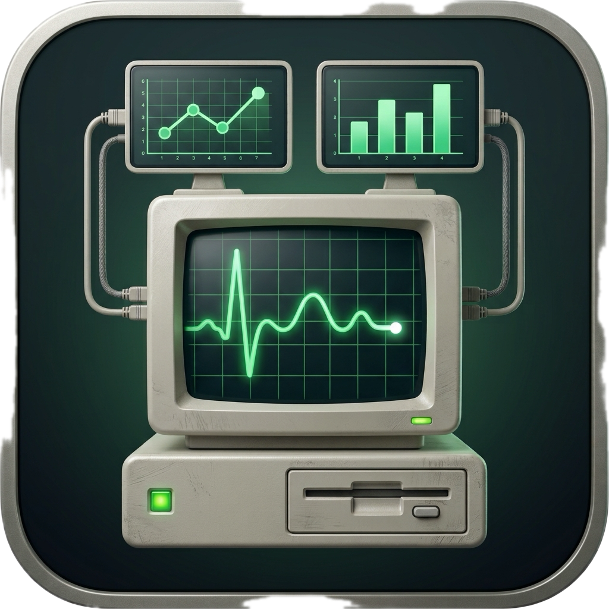

# Apex Activity Manager

**See what your Mac is doing, understand why, and fix it.**

A native macOS activity manager by **CyberNet Labs**: live performance,
diagnostics that explain themselves, drive and storage tools, and battery
control, in one light app that stops working when you're not looking at it.


[**Download for macOS**](https://github.com/sudo-user101/Apex-Activity-Manager/releases/latest) · [Features](#features) · [Install](#install) · [FAQ](#faq)

</div>

<p align="center">
  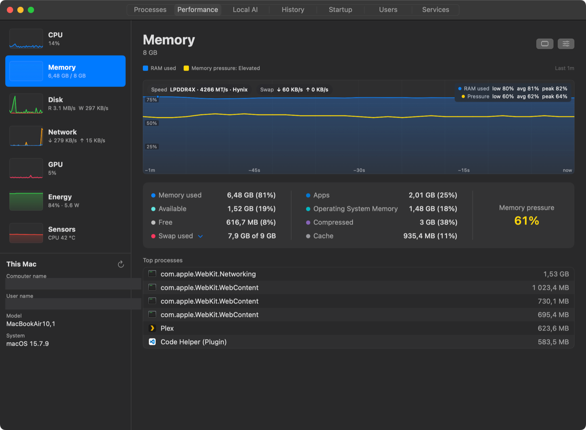
</p>

## Highlights

- **Everything in one window.** Processes, CPU, memory, disks, network, GPU,
  energy, sensors, startup items, users and services, one click apart.
- **Explains, then helps.** Alerts and diagnostics say what happened, why it
  matters and what to do, with the evidence behind them.
- **Drive toolkit.** Drive Doctor, storage clean-up for every drive, live
  file-transfer control and a guided bootable USB creator.
- **Battery care.** Charge limit, scheduled and overnight charging that keep
  working even when Apex is closed.
- **Light by design.** Native Swift, under 10 MB, no tools spawned every
  second, and sampling pauses completely when the window is hidden.
- **Honest numbers.** When macOS doesn't expose something, Apex says so
  instead of guessing.

## Features

### Performance at a glance

Live graphs for every part of the Mac, 1 to 10 minutes of history, and an
advanced graph with exact values on hover.

- **CPU:** total, user and system time, every core (efficiency and
  performance cores labelled); click the graph to see which processes use it.
- **Memory:** pressure (Normal / Elevated / Critical), apps, OS memory,
  compressed, cache, free, swap and how fast it's moving, RAM type and speed.
- **GPU:** utilisation, rendering and geometry load, memory, temperature,
  GPU restarts and the processes using the GPU, including local AI models.

<p align="center">
  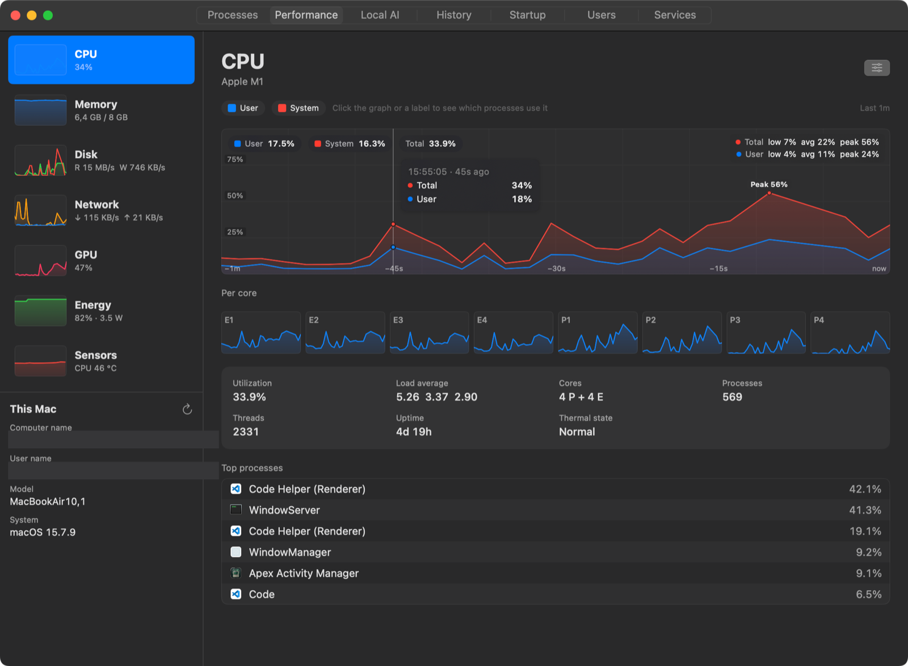
  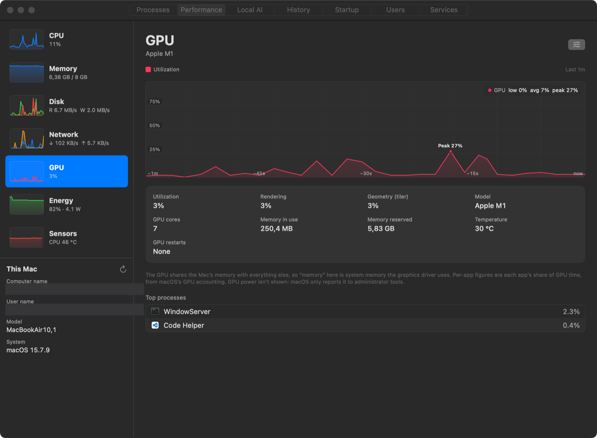
</p>

### Processes, grouped the way you think

- Apps with their helper processes folded underneath, then background and
  system processes; filter, search and sort by CPU, memory, disk, network,
  GPU or energy.
- An inspector for any process: what it is, where it lives, its signature
  and notarization, how long it has run, and its command line.
- End, End Tree, Pause / Resume, change priority, or **Optimize**: keep an app
  running at background priority on efficiency cores, hidden, until you
  restore it.

<p align="center">
  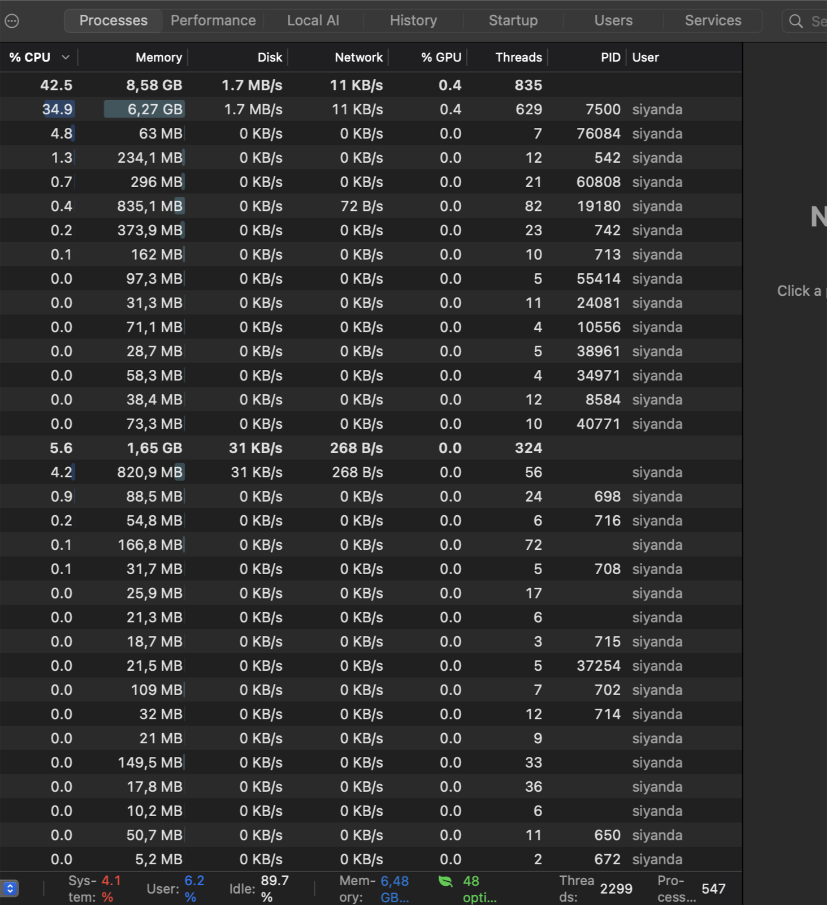
</p>

### Free Up Memory, and put it all back

- See which apps hold the most memory, then **Optimize** them (they keep
  running but give way to everything else), **Quit** them, or clear the
  file cache.
- **Restore** brings optimized apps back on screen; **Reopen** relaunches the
  apps you quit, hidden ones hidden and the front one in front, with their
  windows where the app supports macOS window restoration.

<p align="center">
  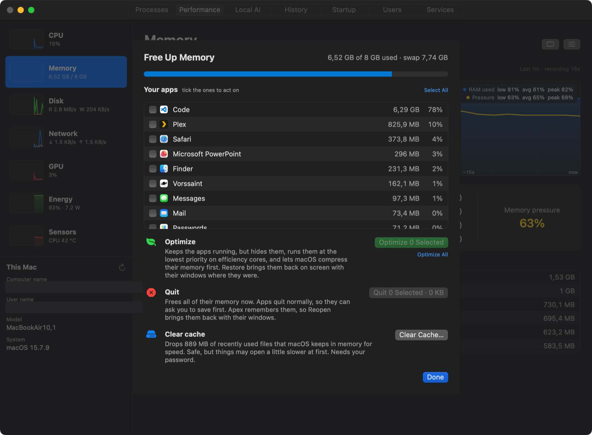
</p>

### Network

- Received and sent over time, your **local IP** per interface (Wi-Fi,
  Ethernet, VPN) marked private or public, router name and model, DNS.
- Per-app traffic and every connection with its remote host, plus listening
  ports with one click to free a port.

<p align="center">
  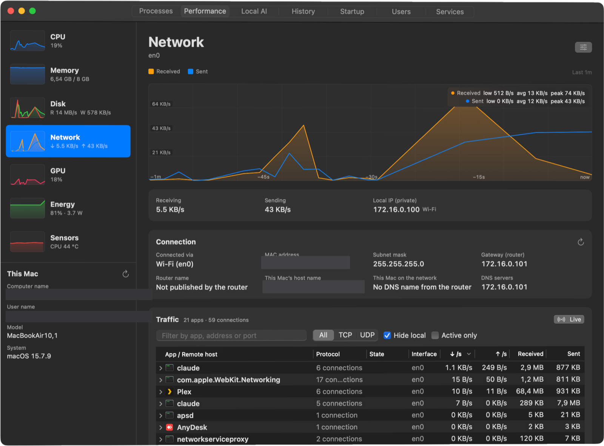
</p>

### Drives, diagnosed

- A page for every drive as soon as it's plugged in: live reads and writes,
  the USB standard it's actually running at (and a warning if a fast drive is
  stuck on a slow port), capacity and volumes, and a one-click eject.
- **Drive Doctor** turns health data into findings: what was detected, why it
  matters, the evidence (from the drive itself, measured by Apex, or reported
  by macOS), severity and confidence, steps in order, and when to get help.
  It estimates remaining life only when the drive's own wear data supports it.
- Read-only **Check for Errors** with macOS First Aid; health changes go into
  History and notify you when a drive becomes at risk.
- **Transfers:** while files copy onto a drive its icon turns blue; see each
  file's progress and destination, cancel it, or move a finished copy that
  went to the wrong place.

<p align="center">
  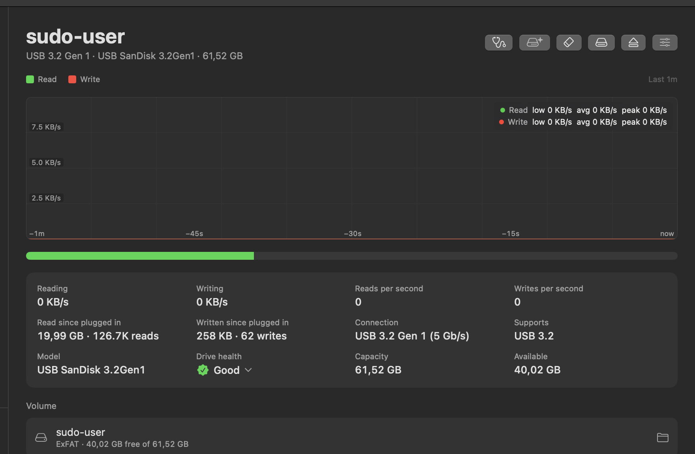
  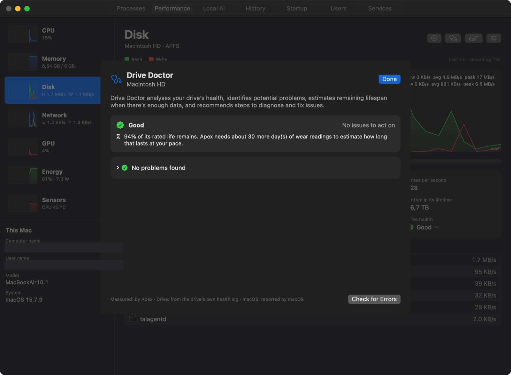
</p>

### Storage, for every drive

- **Optimize** maintenance tasks, **Analyze** what takes the space folder by
  folder, and **Clean** caches, logs, leftovers of deleted apps, old
  installers, build folders and the Trash.
- On external drives: analyze the drive, empty its own Trash, and remove the
  hidden helper files macOS leaves on Windows-formatted drives.
- Everything is listed for review first; nothing is deleted without your say.

<p align="center">
  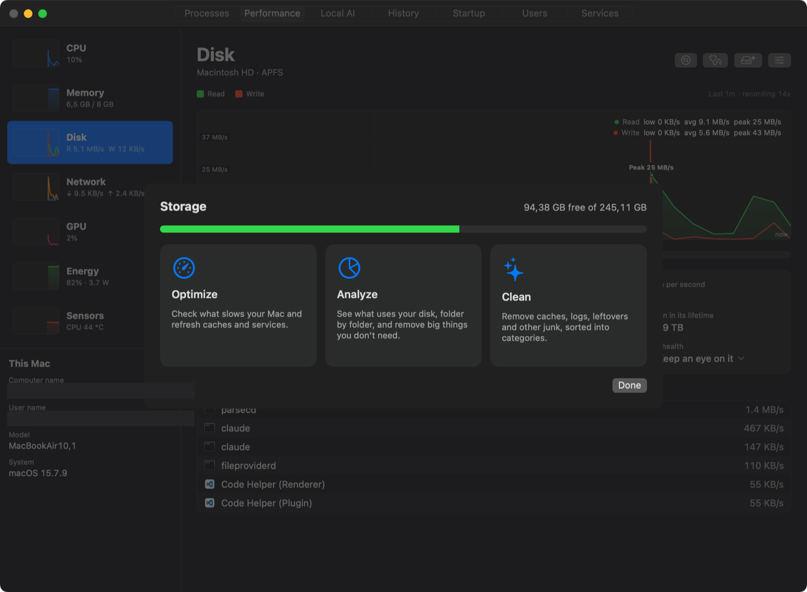
</p>

### Bootable Media Creator

A guided **Image → Drive → Customise → Review → Create** flow for Windows,
Linux and macOS installers, with checks before anything is erased and
verification afterwards.

- Reads a Windows image's editions, build and architecture straight from it.
- Windows 11 setup options, written as an answer file on the USB drive: skip
  the TPM / Secure Boot / RAM checks for older PCs, set up offline with a
  local account, use your region, fewer privacy prompts, and install apps
  such as Chrome, Firefox, VLC or VS Code at first sign-in.

<p align="center">
  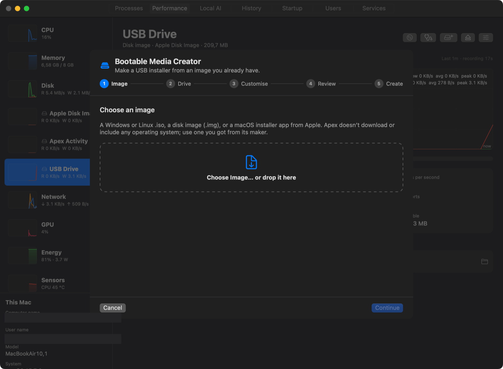
</p>

### Battery and energy

- Per-app power use, whole-Mac power draw, battery health, cycles and a
  12-hour charge history.
- **Charge limit** (50–100 %), **Charge to 100% Now**, weekly **schedules**,
  and **night charging**: hold a lower charge overnight and be full by
  morning, even with the lid closed.
- **Accessories:** every connected USB device (opening hubs and docks into
  what's plugged into them) with the power it's allowed, plus Bluetooth
  battery levels.

<p align="center">
  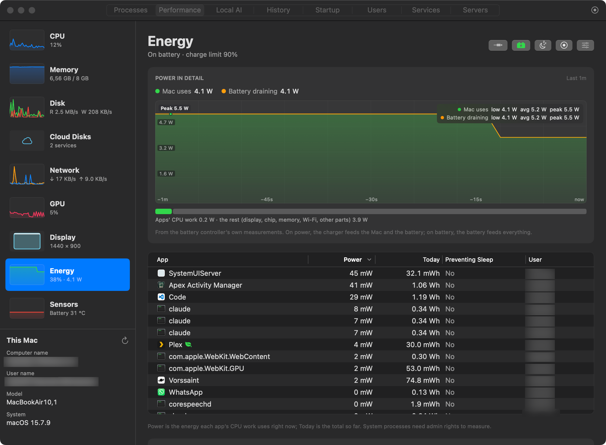
</p>

### Alerts and history

- Notifications for things that matter: an app stuck on high CPU, memory
  pressure, swap growing, an app's memory climbing for half an hour, heat,
  low disk space, a disk filling fast, a drive's health getting worse.
- Short spikes are recorded but never notified; every event explains why it
  fired. Plus 30 days of per-app usage.

<p align="center">
  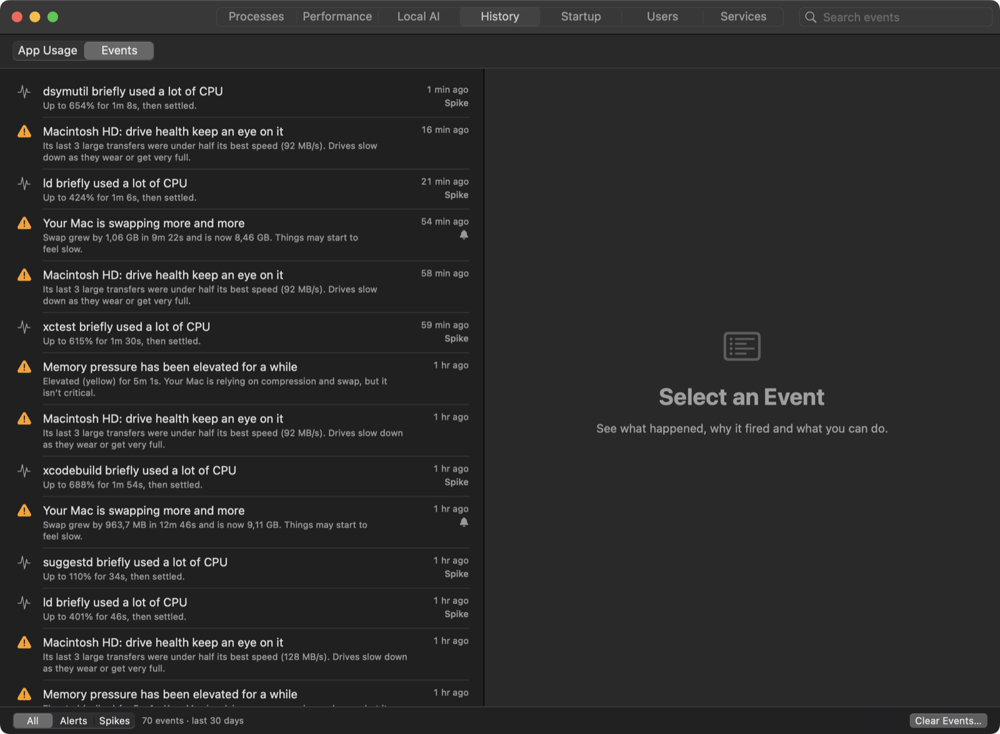
</p>

### And more

- **Startup:** launch agents and login items with readable names, on/off,
  and Add App to open any app at login.
- **Users** and **Services** (start, stop, restart), **Local AI** runtimes
  (Ollama, LM Studio, llama.cpp and more) with their models and memory, and
  a **menu bar** monitor.

## Install

1. Download **Apex Activity Manager 1.0.0.dmg** from
   [Releases](https://github.com/sudo-user101/Apex-Activity-Manager/releases/latest).
2. Open it and drag **Apex Activity Manager** onto **Applications**.
3. The first time, macOS may say it can't check the app (it isn't notarized
   yet): open **System Settings › Privacy & Security** and click **Open Anyway**.

**Requirements:** macOS 14 Sonoma or later, Apple silicon or Intel.

## FAQ

**Does Apex need administrator rights?**
No, not to monitor. You're asked for your password only for actions that
need it: charge limit and fan control (a small helper is installed once),
ending other users' processes, clearing the file cache, raw image writes.

**Will it slow my Mac down?**
It's built not to: about 6 % of one core while you watch the Processes view,
next to nothing when hidden, and it hands memory back to macOS when idle.

**Is anything sent over the internet?**
No. Apex has no analytics and no account. It only looks up what you see on
screen (your router's name, host names of connections) and talks to local AI
runtimes on your own Mac. "Check on VirusTotal" opens your browser with the
file's fingerprint, only when you click it.

**Why can't Apex switch off an accessory's power or show GPU watts?**
macOS doesn't let apps do the first, and only reports the second to
administrator tools. Apex tells you rather than showing made-up numbers.

## Build from source

```bash
./build.sh                       # dist/Apex Activity Manager.app for this Mac
./build.sh --universal --dmg     # Apple silicon + Intel, plus the installer .dmg
swift test                       # unit tests
```

Needs Xcode or the Command Line Tools (Swift 5.10+).

| Path | What's there |
|---|---|
| `Sources/TaskManager/App` | App state and sampling loop, alerts, history, memory guard |
| `Sources/TaskManager/Sampling` | CPU, memory, disk, network, GPU and per-process samplers, device hot-plug |
| `Sources/TaskManager/System` | Battery, sensors, drive health and tools, storage, accessories, transfers, startup items |
| `Sources/TaskManager/Diagnostics` | The diagnostic model and Drive Doctor rules |
| `Sources/TaskManager/BootMedia` | Image inspection, Windows answer files, the media-creation job |
| `Sources/TaskManager/Views` | One file per page or panel |
| `Sources/DetectionCore` | Pure alert rules (samples in, events out) |
| `Sources/FanControlCore` | Pure fan, charge-limit, schedule and night-charging logic |
| `Sources/ApexFanHelper` | The privileged helper (installed only when you turn on charge or fan control) |
| `Tests/TaskManagerTests` | Unit tests |

More: [Architecture](docs/ARCHITECTURE.md) · [Where every number comes from](docs/DATA-SOURCES.md) · [AI diagnostics design](docs/AI-DIAGNOSTICS.md) · [Changelog](CHANGELOG.md)

## Roadmap

- A native **Windows** edition.
- AI-assisted explanations: your own API key, a local model, or an Apex
  subscription ([design](docs/AI-DIAGNOSTICS.md)).
- A Developer ID-signed, notarized release.

## License

Source-available under the [PolyForm Strict License 1.0.0](LICENSE): you may
read, build and use Apex for personal and other noncommercial purposes, but
not modify, redistribute or use it commercially. For other uses, contact
CyberNet Labs through the repository's issues.

© 2026 CyberNet Labs.
